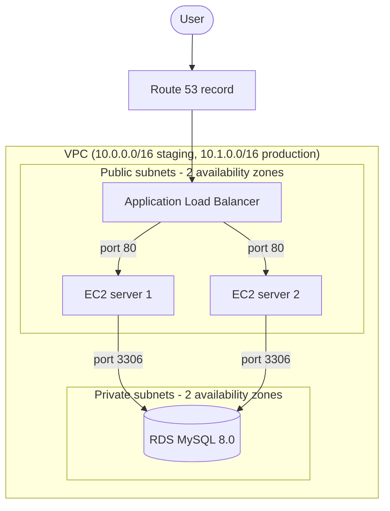
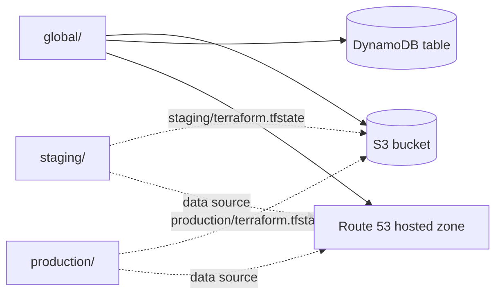

# 05 - Modular 3 tier app with staging and production

Takes the infrastructure from `03` (vpc, load balancer, servers, route53) and the
module practices from `04`, and splits it into a `global` directory plus one
directory per environment.

## Infrastructure



The internet gateway and public route table give the public subnets a way out.
The private subnets have no route to the internet, so the database can only be
reached from inside the vpc.

Security groups are chained instead of using open cidr blocks:

| Security group | Allows inbound from |
| --- | --- |
| load balancer | `0.0.0.0/0` on port 80 |
| servers | the load balancer security group on port 80 |
| database | the servers security group on port 3306 |

## State and shared resources



`global` holds everything that is shared and created once. Both environments keep
their state in that bucket under a different key, and look the hosted zone up
with a `data` block instead of creating their own.

## Layout

```
05/
├── modules/
│   ├── network/          vpc, subnets, internet gateway, route table
│   ├── compute/          servers and their security group
│   ├── loadbalancer/     alb, target group, listener, listener rule
│   └── database/         rds instance, subnet group, security group
├── global/               state bucket, lock table, hosted zone
├── staging/              small instances, staging.example.com
├── production/           bigger instances, example.com
└── test/                 terratest
```

The modules are the same for both environments. Only the values in
`staging/vars.tf` and `production/vars.tf` are different.

| | staging | production |
| --- | --- | --- |
| vpc cidr | `10.0.0.0/16` | `10.1.0.0/16` |
| servers | 2 x `t3.micro` | 2 x `t3.small` |
| database | `db.t3.micro`, 20 GB | `db.t3.small`, 50 GB |
| record | `staging.example.com` | `example.com` |

## Running it

`global` has to be applied first, because it creates the bucket the environments
use for their state and the hosted zone they look up.

```
cd global
terraform init
terraform apply
```

Then an environment:

```
cd ../staging
terraform init
terraform plan -out=tf.plan
terraform apply tf.plan
```

`db_password` has no default, so it is asked for on the command line, or passed
with `-var` or a `terraform.tfvars` file that is not committed.

`global` keeps its own state locally, because it is the thing that creates the
bucket the other directories write to.

## Tests

The tests use terratest and run against real aws resources.

```
cd test
go test -v -timeout 60m -run TestStagingPlanIsValid
go test -v -timeout 60m -run TestStagingInfrastructure
```

`TestStagingPlanIsValid` only runs init, validate and plan, so it costs nothing.
`TestStagingInfrastructure` applies the staging directory, checks the outputs,
waits for the load balancer to answer with the page the servers are serving, and
destroys everything again with a `defer`.
